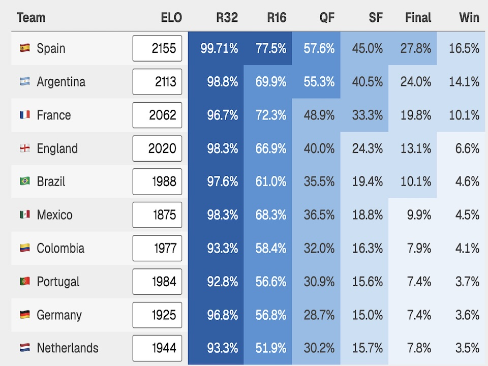

# Football Predictions

[Live demo](https://douwe.com/projects/football_predictions)

Looking for the pre-2026 code? See [`legacy/`](legacy/).



Run the interactive tournament simulator locally with:

```bash
uvx douwe football_predictions
```

Football Predictions simulates international football tournaments from
pre-tournament ratings and tournament definitions. The current version reads
ratings from
[eloratings.net](https://www.eloratings.net/), runs Monte Carlo simulations of
group stages and knockout brackets, and lets you adjust the model directly in
the browser. Controls include ELO predictive strength, home advantage, recent
form, and late-round effects. The model can also be backtested against completed
World Cups and Euros.

## Run It Yourself

The Python simulator can be run directly against any tournament YAML file:

```bash
python3 simulate.py tournaments/wc_2026.yaml
```

Run more or fewer simulations with `--n`:

```bash
python3 simulate.py tournaments/euro_2024.yaml --n 50000
```

Use `--seed` for reproducible output:

```bash
python3 simulate.py tournaments/wc_2022.yaml --n 10000 --seed 1
```

Example output is a table of each team's probability of reaching later stages
and winning the tournament.

## Predict Match Scores

`simulate.py` estimates how often each team reaches each round. `predict.py`
answers a different, concrete question: from the same model, what is the single
most-likely *scoreline* of each match? That is what you need to fill in a
score-prediction pool — one exact score per fixture.

```bash
python3 predict.py tournaments/wc_2026.yaml           # pretty table
python3 predict.py tournaments/wc_2026.yaml --json     # machine-readable
python3 predict.py tournaments/wc_2026.yaml --top 3    # + N likeliest scores
```

It predicts every match whose two teams are known: all group fixtures up front,
and each knockout tie once its feeder results are in. The prediction has three
layers, applied in order:

1. **Model modal score.** The goal model (shared with `simulate.py`) turns the
   ELO gap into expected goals (xG) per team. The most-likely scoreline is the
   mode of each team's Poisson distribution — `floor(xG)`.
2. **Market blend** (optional). If a fixture has betting lines in the YAML's
   `odds` block, its Asian-handicap and over/under lines are converted to a
   market xG and blended 80/20 with the model xG before taking the mode. The
   market prices in injuries and form the ELO snapshot can't see, and corrects
   the flat host bonus for weaker hosts.
3. **Blowout tier.** When the *raw* ELO gap (no host bonus) is ≥ 440, the match
   is so lopsided that `floor(xG)` understates it and we call an outright 4-0.

Matches are flagged `*` (market-blended) and `!` (blowout) in the table. When a
fixture already has an actual result loaded, the table shows it alongside the
prediction with pool points (exact score = 3, correct result = 1) and a running
total — so you can score your own picks as a tournament unfolds.

### Backtest the predictor

`--backtest` scores the predictor on every played group match across all
completed tournaments, against naive baselines:

```bash
python3 predict.py tournaments/ --backtest
```

This surfaced a real finding: the plain modal score **over-predicts draws** (for
even teams 1-1 is the likeliest *score* but not the likeliest *result*).
Conditioning the score on the most-likely win/draw/loss outcome first —
`--outcome-aware` — scores better and edges the favourite baseline. (A naive
"home team wins 1-0" still scores highest, because in these schedules the listed
home/seeded team wins ~68% of group games — a signal the symmetric ELO model
deliberately ignores at neutral venues.)

### In the browser

The same scoring runs in the app: each match shows the model's predicted
scoreline (hover for the win/draw/loss split and the likeliest scores), and a
**Fill predictions** button populates every empty group score in one click — a
ready-made pool entry you can then tweak. Predictions update live as you move the
model sliders.

`predict.py` reuses the model and helpers from `simulate.py`, and its scoring is
mirrored in `static/simulate.js` (`Football.predictedScore`); `test_predict.js`
keeps the two in sync.

## Layout

- `football_predictions.html` — project metadata, template, and page styles.
- `football_predictions.py` — Django project adapter and lazy backtest endpoint.
- `static/simulate.js` — browser/Node tournament simulator.
- `static/app.js` — frontend controls, rendering, and backtesting.
- `tournaments/` — YAML tournament definitions and historical results.
- `fetch_elo.py` — scraper/updater for ELO ratings and match schedules.
- `simulate.py` — Python simulator used by data tooling.
- `predict.py` — most-likely scoreline per match (model + market + blowout).
- `test_*.js` — focused Node tests for simulator/model behavior.

## Data Updates

Tournament YAML files contain:

- `elo` — rating at the tournament cutoff.
- `elo_9m` — rating roughly nine months before the tournament.
- actual group and knockout results, where available.

An optional top-level `odds` block supplies betting lines for the market blend
in `predict.py`, keyed by `HOME-AWAY` team codes (either direction works):

```yaml
odds:
  MX-ZA: { ah: -0.75, ou: 2.25 }   # ah = Asian handicap, ou = over/under total
```

To refresh one tournament:

```bash
python3 fetch_elo.py tournaments/wc_2026.yaml
```

## Country Factors

`build_country_factors.py` builds a country-level dataset for questions like
"what makes countries good at football?" It uses a ten-year monthly average of
Elo ratings as the target, then joins country data from World Bank and Our World
in Data:

- GDP per head, both market-rate and PPP-adjusted.
- Population.
- International migrant stock as a percentage of population.
- Male height.
- Annual hours worked per worker.
- Catholic share of population from Wikipedia's country table.
- World Cup appearances and titles from the YAML files in `tournaments/`.

Run it from the project root:

```bash
../../venv3/bin/python build_country_factors.py --write data/country_factors.csv
```

The script also prints a small model comparison table so we can see whether PPP
GDP, migration, hours worked, Catholic share, and World Cup history improve the
fit.

Latest run, with 213 teams and a five-fold cross-validation split:

| Model | Train R² | CV R² |
| --- | ---: | ---: |
| GDP USD + population + region + height | 0.661 | 0.596 |
| GDP PPP + population + region + height | 0.658 | 0.594 |
| + migration | 0.662 | 0.595 |
| + hours worked | 0.664 | 0.586 |
| + Catholic share | 0.677 | 0.599 |
| + World Cup history | 0.738 | 0.673 |
